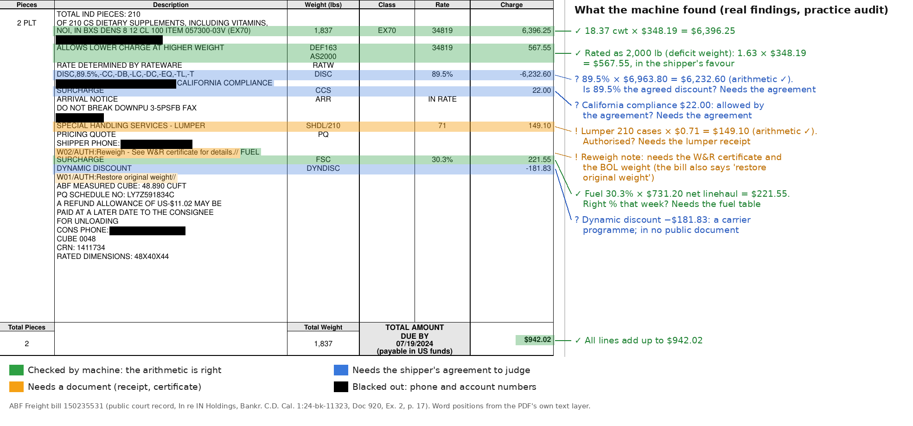

# C-09 software: the initial pitch for the first audit machine

> **Status (2026-10-04).** This is a design study the founders asked for during S5 (validation). ~~It records one decision: the founders' choice, on 2026-10-03, of an **audit-only first version**. It settles nothing else, and nothing is being built.~~
>
> **Updated 2026-10-08.** It records two decisions: the **audit-only first version** (2026-10-03, §1) and **D-23, a software company, not an audit firm** (2026-10-08, §1A). Under D-23 the software flags the bills and the **customer's own staff** review them and file the disputes; we employ no analysts. Text below that assumed our own reviewers is struck through where it appears. Nothing is being built.
>
> C-09 is still a **working bet**, not the final S6 choice. Its ~~frozen~~ kill condition (`research/selection_runs/run-01/4_kill_conditions.md` ~~§2.4~~ §2.5.12, adopted 2026-10-09) still decides whether there is a business at all. The S5 look-backs on real shippers' bills still come first, under the project rule "problem first, solution second".
>
> **Labels:**
> - *verified*: read at the source.
> - *assumed*: a vendor claim, a search snippet or an estimate.
> - **[our calc]**: our arithmetic.
> - **[our call]**: our judgement or suggestion, not a decision.
>
> **Evidence:** three new checks, written for this document:
> - `research/s5_check_AJ_c09_document_reading.md`: reading documents by machine;
> - `research/s5_check_AK_c09_audit_workflow_and_products.md`: how bills are checked today, and what existing products do;
> - `research/s5_check_AL_c09_ingestion_and_data.md`: getting documents and data in.
>
> It also uses the earlier checks AC, AA, Z, Y and T and the practice audit. Source IDs such as N-AJ12 point into those files, where every source is listed with its link.

---

## Summary in plain English

The first product is an **audit machine**. It collects each freight bill and the papers behind it, reads them, works out what the bill *should* have cost under the shipper's own agreement, and puts the bill on screen with the problem lines highlighted and the proof beside them. ~~One click turns a confirmed problem into a dispute in the carrier's own format; the machine then follows the money back and counts our share.~~ *Superseded by D-23 (2026-10-08, §1A):* the customer's own reviewer confirms each problem and files the dispute; helping them file comes later. How we are paid (a share of recoveries or a subscription) is open until Q6. Paying carriers waits until later, as you decided. Your three steps (take the document in, check it against the other documents, show it with the problems highlighted) are the right backbone. The research adds three hidden steps in the middle: sort the pages, double-check that the machine read them correctly, and link the papers that belong to one shipment. It adds three more at the end: send the dispute, track the credit, and report ~~and bill our fee~~ (*D-23:* the customer sends the dispute; the fee form is open).

The biggest surprise is where the cost sits: **reading documents is cheap; people's minutes are not.** A shipper spending $2M a year on freight produces about 10,500-15,500 pages a year. Cloud OCR (optical character recognition) reads them for about **$16-23 a year**, and a leading AI model such as Claude Sonnet for about $200-300, against a fee from that customer of about $3,900. One person spending 6 minutes on one flagged bill costs **$3.68**, the same as the machine reading about 2,450 pages. On the 101 real ABF bills, 58% had a line needing a document or a judgement; at that rate, ~~review time alone would cost 1.6-2.4 times the fee~~ *(superseded by D-23, 2026-10-08: that was our own review cost under the service model)* **the review time is the customer's own staff time under D-23**: about 45 hours a year at a $2M shipper if 15% of bills need a look, about 175 hours at 58% (before disputes) **[our calc]**. So the software's real job is still to **cut people's minutes**, because a queue that takes too long is a queue the customer stops working: clear most bills automatically, group the rest by cause, fetch missing papers from carriers' systems, and make each remaining decision one click on a highlighted page. The hard technical problem is trust, not price. AI readers sometimes invent or "correct" digits, so every number must be found on the page, the bill must add up, and the money math is done by plain code, never by AI.

Today a person checks bills by eye, or nobody does. A logistics coordinator compares each bill with the quote, approves it if it is close enough, and often just books the difference as an expense. Booking tools such as Freightview compare quote and invoice, but only for loads booked through them, and audit firms serve mostly big shippers. So a highlighted document fits how people already work. But most of the money on the ABF bills sat on lines that need papers *not on the bill*, so **the screen must also show what proof is missing, and go and get it.** Documents come in by upload first, then by a forwarding email address per customer (it costs pennies), then from carriers' own document services, then from the shipper's accounting system. We suggest **starting with the S5 look-backs themselves**, run with scripts, and building nothing bigger until a look-back shows the money is there. The decisions left for you are in §13.

---

## 1. The decision on record: an audit machine first

**Initial decision (founders, 2026-10-03, verbatim):**
> "I have decided the first rendition will just be an audit machine, we can do payments later"

**Evidence for it:**
- **The research already suggested it.** Audit-only was the suggested first product, because it can start without the slow parts. It lifts C-09's Axis W score from 55 to 65 and its Cohen score from 1 to 10 (`6_decision.md` §2; `6_focused_target.md` §1.4, point 2).
- **Nothing changes in how the shipper pays.** There is no new billing address, no bank partner and no carrier sign-up. A forwarding inbox, the agreements and an export of paid bills are enough to start (check AK §7.2) **[our call]**.
- **Taking over payment is slow and unpopular.** It takes months: an accounting-system link, a bank partner and carrier sign-ups (`6_decision.md` §2). Carriers also resent payment services that charge them to get paid. AvidXchange is rated 3.6 from 70 reviews, mostly by suppliers being paid (check Z §8, *assumed*).
- **Controlling the payment isn't needed to dispute properly.** Paying less than billed (a "short pay") is barred by most LTL carriers' rules anyway; ODFL, Estes, XPO, Saia and TForce all forbid offsets. XPO requires the bill to be paid before an overcharge claim (check AK §2.3, §5.1, *verified*).

**Evidence against it (what it costs):**
- **Payments are where the big providers earn and lock customers in.** U.S. Bank charges carriers 1% or more for early payment (check Z §10.1, *verified*).
- **An error caught before payment leaves no refund to share.** The shipper disputes, the carrier re-bills, and the saving shows up as a corrected invoice, not a credit memo (`6_focused_target.md` §4.4, point 6). How we would be paid for those catches is a pricing question, and pricing belongs to Q6 **[our call]**.
- **Some checks are worth most before payment.** A truckload bill sold to a factoring company can be billed twice: once by the carrier and once by the factor. After notice, paying the carrier doesn't settle the debt (UCC 9-406(a), check AL §3.4, *verified*).

**Finalized decision:** **decided by the founders on 2026-10-03.** Version 1 is an audit machine; paying carriers is a later growth option. The decision is also noted in:
- `handoff_s5_interviews.md` §4 (row 9);
- `6_focused_target.md` §1.4;
- `C09-business-proposal.md` §8.2.

---

## 1A. The second decision on record: a software company, not an audit firm (D-23)

**Initial decision (founders, 2026-10-08, verbatim):**
> "We have no analysts, this is a software company. A software as a service, we do no manual reviews here. We offer a tool that can automatically catch things for them and raise the concerns to their human reviewers. Mark this down and update all of the relevant models to contain this. We will help them file disputes, eventually, but they just review and file currently."
>
> "Create a HANDOFF.md, we will re-run the kill test. THis is not an auditing firm but a software company."

**The founders' answers to the follow-up questions the same day (their choices, verbatim):**

| Question put to them | Answer |
|---|---|
| In the kill-test re-run, how should our revenue per customer be modelled? | "Both, side by side": a share of recoveries and a subscription. The price itself stays a Q6 decision |
| How much new research should the re-run do? | "Targeted checks + adversarial" |
| Who puts each customer's rate agreements into the software? | "Customer uploads, software reads": the customer confirms the rules the software found |
| Does "we have no analysts, this is a software company" apply to C-19 too? | "Yes, flag C-19 for later": the rule is company-wide; C-19 gets the same re-run before the two cards are compared at S6 |
| What should the handoff file be called? | "handoff_c09_software_rerun.md": `HANDOFF.md` would collide with the existing `handoff.md` on a Mac, in Windows or in a zip |

**What it settles:**
- **C-09 is software sold as a service.** We employ no analysts and do no manual review. Every model, for this card and any other, costs only software, support and selling on our side.
- **The software catches the errors and raises them to the customer's own reviewers.** The customer reviews and files the disputes. Helping them file comes later.
- **Self-serve onboarding:** the customer uploads its rate agreements, the software reads them, and the customer confirms the rules.
- **§7.5 is answered:** option A (the customer reviews in our tool), with E (a yes/no question queue for facts only the shipper knows) as a feature. The suggestion "B with E" (our analysts review) is superseded.
- **The kill condition is re-run.** The frozen lines (`research/selection_runs/run-01/4_kill_conditions.md` §2.4) were derived from our own review cost. The re-run is briefed in `handoff_c09_software_rerun.md`. ~~The frozen lines stay in force until the founders adopt new ones.~~ *The founders adopted the re-run's lines on 2026-10-09 (C29, §2.5.12).*

**Evidence for it:**
- **The biggest cost leaves our books.** A person on 15-58% of bills was the line that decided the service model (§5.2-5.3). Of the old $1.12 per bill, $0.10 (machine reading) stays ours and $1.02 becomes the customer's own staff time **[our calc]**.
- **Carriers' payer-only rules stop mattering, because the shipper files.** TForce bars agents and third parties from requesting guarantee refunds, FedEx Freight may refuse a third party's request, and AAA Cooper wants claims "submitted by the responsible party" (check AO, *verified*).
- **It fits the paid-hours rule.** The saving is recovered overcharges. The software asks the customer for hours rather than cutting them.

**Evidence against it (what it costs):**
- **It hands back the job "nobody has time for".** At $2M of spend and 1.5 bills per $1,000, the customer's staff would need about **45 hours a year** if 15% of bills need a look, and about **175 hours** at the practice audit's 58% (6 minutes each, before disputes) **[our calc]**. A flag nobody works recovers nothing.
- **Our revenue under a share of recoveries depends on the customer's follow-through,** and we no longer see the credit memos, so the share is harder to count and to bill (fee feasibility F2-F3, `submarket_selection.md` §5.4).
- **It puts us head to head with self-serve tools.** Freightview (4.7 from 743 reviews, $149 a month for up to 50 shipments), MyCarrier and FreightPOP already give mid-sized shippers an audit screen. Theirs compares the bill with the booking quote, not the rate agreement, and covers only loads booked through them (check Z; ratings *assumed*).
- **A subscription needs a budget line; a contingency fee does not** (`5_validation.md` §2) **[our call]**.
- **Kill Test 3 measured our own review cost**, so it has to be restated.

**Open for the founders (not decided here):**
- **Does a subscription meet the fee rule?** `CLAUDE.md` says "our fee can be a share of it". `submarket_selection.md` §5.4 already lists "a platform fee plus a success bonus" as a hybrid, and C24 counts labour as money only where it turns into cash. Any change needs a `submarket_selection.md` §9 entry. *Answered 2026-10-08 (founders): "A Subscription. We market it as a scoop off the top of the money they will make, but it will not be contingent on them actually making money." Recorded as `submarket_selection.md` §9 C28.*
- **The fee form and the price:** Q6.

**Finalized decision:** **decided by the founders on 2026-10-08 (D-23).** Also noted in:
- `handoff_s5_interviews.md` §4;
- `6_focused_target.md` §1.4;
- `C09-business-proposal.md` §8.2;
- `research/selection_runs/run-01/6_decision.md` §5;
- `research/selection_runs/run-01/4_kill_conditions.md` §2 (banner) and §4 (C-19 banner);
- `CLAUDE.md`.

---

## 2. The machine at a glance

```
YOUR THREE STEPS        THE MACHINE'S ELEVEN STEPS
----------------        ----------------------------------------------------------------
1. Ingest          -->   1  Collect           upload, forwarded email, carrier document
                                              service, EDI, accounting export
                         2  Split and sort    one PDF -> invoice / BOL / delivery receipt /
                                              certificate / statement
2. Scan, do our    -->   3  Read              the words, and where each sits on the page
   math, check                                (text layer; OCR only for scans)
   against the           4  Check the         every number found on the page; the bill
   other documents          reading           adds up; two readings agree
                         5  Link              bill + BOL + delivery receipt + certificate +
                                              agreement version + payment record
                         6  Re-price          plain-code rules: what should it have cost?
                         7  Findings          billed vs should-be, the proof, the deadline,
                                              grouped by cause
3. Display with    -->   8  Review            the bill with highlights, the proof beside
   highlights                                 it, one-click choices
(not yet named)    -->   9  Dispute           a packet in the carrier's own form layout,
                                              filed in the shipper's name
                        10  Credit            match the carrier's credit or refund
                        11  Fee and report    our share of what came back; monthly summary
Throughout         -->      Alerts            deadline clocks, questions waiting, weekly digest
```

- **Steps 2, 4 and 5 are the hidden middle.** Without them the screen would show wrong numbers, or the right numbers with no proof.
- ~~**Steps 9 to 11 are where the money becomes real.** Our fee is a share of what the carrier actually credits back.~~
- *Superseded by D-23 (2026-10-08, §1A):* **step 8 is done by the customer's own reviewer, and step 9 is filed by the customer.** In version 1 the software shows the proof and the deadline; helping the customer file (a packet in the carrier's layout) comes later. Step 10 still matters, because recovered money is what the customer buys. Step 11's "our share" is open: the re-run models a share of recoveries and a subscription side by side, and the price is Q6 (`handoff_c09_software_rerun.md`).

---

## 3. Q: How are discrepancies found today?

> "How are these being identified currently, if it is just a person looking at the document and checking themselves then we definitely want to display the document and highlight things for them just to help with their existing processes."

**Short answer:** mostly a person, by eye, against a quote, or nobody at all. Your instinct holds. But the screen has to show the *missing proof* as well as the problem.

**What we found:**

| Route | Who and how | What they compare against | Limits | Evidence |
|---|---|---|---|---|
| **1. By eye** | A logistics coordinator or freight-bill clerk opens the PDF, finds the quote or rate confirmation, scans the extra lines, and approves it if it's within an informal "payment tolerance". Otherwise they email the carrier, or just book the difference as an expense | The quote, the rate confirmation, the PO, sometimes the BOL | No tool. Supporting papers are often not on hand. Under time pressure, bills "just get paid" | Job postings (check Y, *verified*); ERP forums (check Z §2, *assumed*) |
| **2. Booking-tool audit screen** | Freightview, MyCarrier and FreightPOP compare each invoice with the quote stored at booking. They offer queues, Yes/No accept, and auto-accept within a % or $ limit | The **quote**, not the agreement | Only loads booked through the tool. Reviewers complain the audit tab "only shows some freight companies" | Check AK §2.2 (*verified* product pages); check Z §7 |
| **3. Audit firm or audit-and-payment provider** | Re-prices every bill against the contract. Exceptions go to an analyst, or to a portal showing the bill image and a choice of standard reasons. Cass had exactly this screen in 2009 | The agreement version in force, the tariffs, the shipment data | Built for large shippers. Setup takes weeks to months | Check AK §2.2, N-AK50 (*verified*) |

- **Who does the checking:** in 47 job postings at US manufacturers and distributors, the duty sat with **logistics staff in 22**, freight-bill specialists in 11, and **accounts payable (AP) in only 6**.
  - A typical duty: "Audit freight invoices for accuracy against contracted rates, shipment records, purchase orders, bills of lading, and TMS data" (check Y, *verified*).
- **Few use software:** only about 10-15% of shippers spending $25-75M a year on freight use a transportation management system (TMS), and about 10% below that (an old 2015 figure, check Y §2.2). Most of our segment is on route 1.

**What it means [our call]:**
- **Show the document.** The person is already looking at it, so put it in front of them with the problem lines lit up and the reason written in plain words.
- **Say *why* and *what proves it*, not just *where*.** "Fuel 30.3% vs 28.9% in your table for that week" is useful. A yellow box alone is not.
- **Show what is missing.** On the ABF bills, **59 of 101 (61% of the dollars)** carried a line that can only be judged with a paper that isn't on the bill (practice audit §3.1). So the screen must show which paper is missing, and fetch it or ask for it.

**Decision:** a review screen built around the document, for the person who checks bills today, is **suggested [our call]**. It is for you to confirm.

---

## 4. Q: What do the files look like, and what goes wrong reading them?

> "given the formats of these documents (PDFs or other standardized document templates, beyond just file format like how the actual document(s) are textually formatted) what issues might arise and what outstanding software solutions would we have to devise?"

**Short answer:** the files come in three shapes. Carriers' own invoices are mostly clean digital PDFs; the papers behind them are scans and photos; and every carrier lays out its bill in its own way. We found 15 concrete traps, each with a known fix.

### 4.1 Three shapes of input

1. **Data files: EDI 210 (the standard electronic freight invoice), CSV or XML.**
   - These are the cleanest.
   - Watch out: once a shipper takes EDI, some carriers stop sending the paper BOL and delivery receipt (TForce). Some leave the class, the dimensions and the proof of delivery out of the file (Estes) (check AC §2).
2. **Born-digital PDFs:** the carrier's own invoice, made by its billing system and emailed.
   - A text layer inside the PDF holds every character and its position, so nothing has to be "recognised".
   - **The 101 ABF bills read cleanly:** 99 added up to the cent, and the other 2 were slips in our own parser (practice audit).
3. **Image bundles:** pictures of paper.
   - FedEx Freight's "PDF Image Delivery" puts the invoice, BOL and delivery receipt in one PDF.
   - Truckload carriers' factoring packets are often phone photos.
   - Anything that passed through an AP team or a 3PL tends to come back scanned, stamped and circled, as the SEFL court set did (check AJ §2.1-2.2, *verified*).

### 4.2 The documents, one by one

| Document | Usual form | The hard part | What we need from it |
|---|---|---|---|
| **Carrier invoice** | Born-digital PDF or EDI 210 | Each carrier's own layout and charge codes. Corrected and "balance due" bills reuse the same PRO number | Every charge line, the PRO, the ship and bill dates, the BOL number |
| **Carrier statement or digest** | One PDF or CSV listing many bills | It isn't an invoice; treating it as one creates false duplicates | Which bills are open or paid |
| **BOL (bill of lading)** | Scan or photo, with a PRO sticker the driver applies | Handwritten weights, counts and ticks | Weight, pieces, class, the services ticked (liftgate etc.), who pays the freight |
| **Delivery receipt (POD)** | Scan with signature, tick-boxes, "wait time" boxes | Handwriting and stamps | Delivery date and time, exceptions noted, services, waiting time |
| **W&R or inspection certificate** | A carrier-made PDF plus photos, from the carrier's portal | Not public anywhere; the layout is unknown until we see real ones | The re-measured weight and dimensions, the date, the device |
| **Lumper or detention receipt** | A paper photo | Often doesn't exist | Amount and authorisation |
| **TL rate confirmation** | Born-digital PDF; one layout per broker (one vendor keeps 18) | Many layouts | Linehaul, fuel, the rules for extras |
| **Rate agreement** | A long PDF of tables, in several dated versions | Tables, versions, clauses ("subject to general rate increase") | Discounts, minimums, FAK classes, extras' prices, effective dates |
| **Fuel table** | Carrier web page or PDF; the percentage changes weekly | Only today's table is published | % by diesel price band, and which week applies |
| **Carrier rules tariff** | A long PDF, versioned | Old versions disappear | The prices and rules for extras |
| **AP export** | CSV or Excel from the accounting system | Column names vary | Paid date, amount paid, payment reference |

### 4.3 The fifteen traps, with real examples, and the fix for each

| # | Trap | Real example | Fix **[our call]** |
|---|---|---|---|
| 1 | Several bills in one PDF; copies of the same page | The ABF court file: 107 pages = 101 bills + 6 copies; one page held two bills | Split on the PRO number; remove exact copies |
| 2 | Invoice + BOL + delivery receipt in one file | FedEx PDF Image Delivery | Sort each page by type (§5.8) |
| 3 | Statements that look like invoices | XPO and Estes digests; SEFL "past due" reprints | Use them only to check what is open or paid |
| 4 | Corrected and "balance due" bills reusing the PRO | XPO "CORRECTED INVOICE"; 4 corrected ABF bills; a SEFL shipment from 2023 billed in 2025 | Key on PRO + version; keep both the ship date and the bill date |
| 5 | Each carrier's own charge codes | ABF: MCADJ (minimum-charge adjustment), SHDL (lumper), DETND (detention). XPO: LP1-LP6 (late fees). SEFL: "DISCOUNT PERCENTAGE 9100" (which means 91.00%) | A code dictionary per carrier |
| 6 | Rates per 100 lb ("cwt") | 16.15 cwt × $304.71 = $4,921.07; XPO prints "M" instead of a rate for a minimum | Convert units; recompute every line |
| 7 | Deficit-weight and minimum-charge lines | "ALLOWS LOWER CHARGE AT HIGHER WEIGHT … AS2000"; "ABSOLUTE MIN CHARGE ADJUSTMENT" bringing a bill to exactly $180 | Treat them as adjustment lines with signs |
| 8 | Credits in brackets or with a minus | XPO "(293.92)"; ABF "−6,232.60" | Read the sign explicitly; rely on the sum check |
| 9 | Text that looks like money | "READY 1.00 PM" was read as $1.00 by our own parser | Take amounts by column position; sum check |
| 10 | Columns lined up by position | Plain text loses which number belongs to which row | Keep word positions (coordinates), not plain text |
| 11 | Handwriting, stamps, signatures | SEFL: circles and a "POSTED" stamp; tick-boxes and wait times on delivery receipts | Show to a person; never resolve automatically |
| 12 | Poor scans and faxes | SEFL OCR errors. Some scanners even swapped digits during compression (Xerox, "sixes were replaced by eights") | Keep the original file; send very poor pages to a person |
| 13 | Tables running over two pages | A delivery receipt's total "NEXT PAGE" | Join the pages before checking the sum |
| 14 | Two dates, only one printed | ABF and XPO show either the ship date or the bill date in places | Keep both; take the missing one from the BOL |
| 15 | Look-alike duplicates | On a minimum-charge account, many bills are $180 + $22 on the same day | Match duplicates on PRO + BOL, never on amount + date |

Source: check AJ §2.4, built on the practice audit and the real court sets in check AC (*verified*).

### 4.4 What we must build to handle all this [our call]

1. **A page sorter:** split files and label each page as invoice, BOL, delivery receipt, certificate, statement, credit memo, or notice of assignment.
2. **A carrier dictionary:** per carrier, its layout, charge codes and PRO number format. Start with the 10 or so LTL carriers that most of the first customers use, and handle the long tail with AI plus checks.
3. **A reading layer that keeps positions:** every word carries its place on the page. That is what makes highlighting possible.
4. **Reading checks:** sum, found on the page, two readings agree, check digits (§5.4).
5. **A shipment linker:** bill ↔ BOL ↔ delivery receipt ↔ certificate ↔ payment, keyed on PRO + BOL + carrier, with versions.
6. **An agreement library:** every version with its effective dates.
7. **A person for handwriting.**

---

## 5. Q: PDF scraping, OCR or AI, and is OCR pricey?

> "PDF scraping in general is a grab bag of issues, we might consider OCR but this could get pricy. Look into this avenue heavily."

**Short answer:** use all three, in layers, each where it's strong.
1. Read the text layer of digital PDFs exactly and for free.
2. Use OCR only on scans, at about $1.50 per 1,000 pages.
3. Use AI only to turn words into named fields, never to do the money math.
4. Check every reading before trusting it.

**OCR is not pricey. People are.**

### 5.1 Five ways to read a page

| Way | How it works | How accurate | Cost per 1,000 pages | Positions for highlighting? | Watch out |
|---|---|---|---|---|---|
| **Text layer** (pdfplumber, pypdfium2, poppler) | Reads the characters stored inside a digital PDF | **Exact.** Nothing is guessed | about $0 | **Yes**, every word, exactly | Doesn't work on scans |
| **Layout templates** (invoice2data, Docparser, Sensible) | Hand-made rules per sender and layout | Exact while the layout holds | $78-390 (Docparser) | Depends on the product | Breaks when a layout changes. Truckload has many layouts. Monthly minimums |
| **OCR** (Tesseract, PaddleOCR; cloud: AWS Textract, Azure, Google) | Recognises characters in a picture | Good on clean scans. Every system scored only **29-50% on old scans** in one public benchmark | **$1.50** in the cloud; cents self-hosted | **Yes**, every word, with a confidence score | Weak on handwriting and low-resolution faxes |
| **AI models** (Claude, Gemini, GPT; open models) | Read the page and return named fields | Best result: **96.5% of invoice fields on clean invoices, 92.7% on scans; about 85% on handwritten forms** | Gemini Flash about $1.50; Claude Sonnet 5.5 about $17; Opus 5.5 about $34 **[our calc]** | Claude: page numbers only. Gemini and Qwen: boxes | **They invent or "fix" digits** (§5.4) |
| **Grounding services** (Reducto, LandingAI, Extend, LlamaExtract) | AI extraction that returns a box around each value | Vendor claims only | $5.50-62.50 | **Yes**, per value | Vendor minimums and lock-in |

Sources: check AJ §3 (prices *verified* at the vendors' pages; accuracy figures from papers and benchmarks; vendor-run benchmarks are *assumed*).

### 5.2 Is OCR pricey? A worked example [our calc]

> **Service basis, superseded by D-23 (2026-10-08, §1A).** The "person" rows below were costed as **our own** reviewers. Under D-23 we employ no analysts: the machine-reading rows stay ours, and the person rows are the **customer's own staff time**. Of the old $1.12 per bill, $0.10 (machine reading) stays ours, and $1.02 (a person on 15% of bills for 6 minutes, $0.55, plus disputes on 5% at $9.30, $0.47) becomes the customer's time **[our calc]**. Our cost per customer is now reading + storage + support + licences, re-derived in `handoff_c09_software_rerun.md`. The fee line ($3,937.50 at 25%) is the old contingency model; the fee form is open until Q6.

The customer spends **$2M a year** on truckload and LTL freight. The inputs:
- **Bills per $1,000 of spend:** 1.5 in the model, or 2.21 on the real ABF account, which is heavy on small LTL shipments.
- **Pages per bill, with its papers:** 3.5.
- **Our fee, at the model's middle inputs:** $3,937.50 a year (1.5% overcharged × 70% caught × 75% credited × 25% fee).

| Cost a year | Model account (1.5 bills per $1,000) | LTL-heavy account (2.21) |
|---|---|---|
| Pages read | 10,500 | 15,470 |
| Cloud OCR, $1.50 per 1,000 pages | **$16** | **$23** |
| Document-AI invoice model, $10 per 1,000 | $105 | $155 |
| Gemini 2.5 Flash pass | $18 | $26 |
| Claude Haiku 4.5 pass | $87 | $128 |
| **Claude Sonnet 5.5 pass** | **$201** | **$296** |
| Claude Opus 5.5 pass | $403 | $594 |
| Grounding service, $15-62.50 per 1,000 | $158-656 | $232-967 |
| **A person looks at 15% of bills, 6 minutes each, US wage** | **$1,656** | **$2,439** |
| **A person looks at 58% of bills (as on the ABF set), US wage** | **$6,401** | **$9,431** |
| ~~The same 58%, offshore reviewer at $12 an hour~~ *(moot under D-23: no reviewers of ours, offshore or not)* | ~~$2,088~~ | ~~$3,076~~ |

**Reading:**
- One 6-minute review at the US loaded wage ($36.79 an hour) costs **$3.68**. That equals cloud OCR on **about 2,450 pages**, or 55 reads of a whole bill packet by Claude Sonnet 5.5.
- The machine-reading line is a rounding error. ~~The person line decides the business.~~ *D-23 (2026-10-08):* the person line is now the customer's time. It still decides the business, but differently: it decides whether the customer keeps working the queue, not whether we make money on each bill.
- Prices: check AA §2 and check AJ §9; Anthropic list prices re-checked on 2026-10-03 (*verified*).

### 5.3 The lever: what the software has to achieve [our calc]

> **D-23 (2026-10-08):** the dollars below are now the **customer's** staff time, valued at the US loaded wage, not our cost. Set against the old contingency fee of $3,938 they show how much of the recovered money the customer's own hours would eat. The re-run treats those hours as capacity, with the wage only as a sensitivity (`handoff_c09_software_rerun.md` §3).

Yearly review cost at the $2M LTL-heavy account (4,420 bills, US wage), compared with a fee of $3,938:

| Share of bills a person must look at | 6 minutes each | 3 minutes | 1.5 minutes |
|---|---|---|---|
| 58% (the ABF bills as they came) | $9,431 | $4,716 | $2,358 |
| 30% | $4,878 | $2,439 | $1,220 |
| 15% (the model's assumption) | $2,439 | $1,220 | $610 |
| 5% | $813 | $407 | $203 |

**In plain words:** the business only works if the software gets most bills to "no person needed", and makes each remaining look short. That is what these are for:
- automatic clearing within tolerances;
- grouping by cause;
- fetching certificates automatically;
- one-click questions to the shipper;
- the highlighted screen.

**A note on your rule about paid hours:** ~~this table is about **our own** cost of serving a customer.~~ *Superseded by D-23 (2026-10-08):* this table is now about **the customer's own** staff time on the queue. What the customer pays for is still money the carriers give back, not hours saved. The screen helps the person who checks bills catch more money; it isn't meant to replace them. That fits your rule of 2026-09-22: "I dont care for creating software that cuts paid hours."

### 5.4 Trust: making a reading safe enough to dispute with

**AI readers do invent things** (check AJ §4.1, *verified* from the papers' abstracts):
- On damaged invoices and ID cards, models lean on "linguistic priors" and "frequently" produce "hallucinatory content".
- In another study, AI models made fewer character errors than classic OCR. But they "normalised" spellings, made up content and swapped meanings. These errors are "invisible to standard metrics".
- On handwriting, several models "hallucinate plausible but visually unsupported corrections".

**A wrong claim costs money and credibility** (check AJ §4.3, check T):
- ODFL charges **$50** on claims it settles "through no fault of Carrier".
- A claim is closed 30 days after ODFL's ruling, and can't be reopened.
- TForce accepts claims only from the payer.
- Overreaching look-backs end in court: Exist v. SEFL. In Central Freight v. Amazon, the demand was cut by about 46% because of the claim window (*assumed*: the carrier's account, check AC §5.1).

**Six checks outside the model** [our call, from check AJ §4.2]:
1. **The bill adds up.** On the ABF set this caught our own parser's mistakes.
2. **Every number is found on the page, at a position.** If the AI returns a value whose characters aren't on the page, it becomes an exception.
3. **Two independent readings agree**, e.g. the text layer and OCR, or OCR and AI.
4. **Format checks.** XPO's PRO numbers carry a check digit: the first 8 digits ÷ 7, remainder (*verified*). BOL numbers in the GS1 standard carry another. Carrier codes (SCAC) come from a licensed list.
5. **The papers agree with each other**: weight, pieces, dates and BOL number across the invoice, BOL and delivery receipt.
6. **A person confirms every figure that goes into a dispute**, looking at the page image.

**Two rules to build in from day one [our call]:**
- **"No number without a place on the page."**
- **"The AI never does the money math."** Re-pricing, fuel, discounts and minimums are plain code that gives the same answer every time. The AI may draft the dispute letter; a person approves it.

### 5.5 The layered reading pipeline we suggest [our call]

1. **Data first.** If the carrier sends EDI, CSV or XML, use it.
2. **Text layer next.** For digital PDFs, take the words and their positions exactly (pdfplumber or pypdfium2).
3. **OCR for scans.** Use a cloud OCR that returns word positions and confidence (AWS Textract or Azure Read, at $1.50 per 1,000 pages).
4. **AI to name the fields.** It maps words to "PRO", "discount", "fuel %" and so on, and must point to the words it used.
5. **The checks in §5.4.**
6. **Plain-code re-pricing** against the agreement version in force on the ship date.
7. **Exceptions only** go to a person, on the highlighted screen.

### 5.6 Build or buy, and the licence traps

**Build** (this is where our edge is):
- the text-layer reader;
- the carrier dictionaries;
- the rules engine;
- the review screen;
- the dispute-packet builder.

**Buy:**
- OCR by the page, from AWS or Azure;
- AI by the call, from Anthropic or Google.

**Avoid platforms with monthly minimums at the start.** Rossum is $18,000 a year, Sensible $5,388 and Unstract $5,988. Each is more than the whole fee from a $2M customer (check AJ §9).

**Licences** (check AJ §3.2; key items re-checked):
- **Safe to use (MIT, Apache or BSD):** pdfplumber, pypdfium2, Tesseract, PaddleOCR, docTR, Docling, olmOCR, DeepSeek-OCR, zxing-cpp, PDF.js, react-pdf-highlighter-extended, pypdf.
- **Avoid, or pay for a licence:**
  - **PyMuPDF** (AGPL, or a commercial licence from Artifex);
  - **Unstract** (AGPL);
  - **MinerU 2.5 model weights** (AGPL);
  - **LayoutLMv3** and **Qwen2.5-VL-3B** (non-commercial only).
- **Free only while small:** the Marker and Surya model weights, under $5M of funding or revenue.

### 5.7 The hardest document: the rate agreement

**Why it is hard:**
- Agreements are dated tables: discounts by lane, minimum charges, freight-class ranges, prices for extras, exclusions.
- One SEFL customer had **three versions** in three years.
- Matching each bill to the right version is "the actual audit work" (practice audit §4).
- **No one publishes how long loading one takes.** Vendors claim 98-100% AI extraction (*assumed*).

**Suggested method [our call]:**
1. An AI drafts the loaded schedule.
2. A person checks every number with the clause highlighted beside it.
3. The load is **back-tested against the customer's own bills**. The ABF bills alone reveal the 89.5% discount and the $180 minimum.
4. Every version is stored with its dates.

Check AJ estimates **1-3 hours per carrier version**. Time it on the first look-back.

**Fuel tables:**
- Carriers publish only today's table, and differ on which week a diesel price applies.
- Archive their pages **weekly from day one**. It costs almost nothing.
- ODFL keeps a history tool online. Internet Archive captures of other carriers' pages are months apart (check AL §5).

**Base rates** are what an LTL discount is taken from:
- They are licensed (SMC3 CzarLite; price unpublished).
- Carriers' rate-quote services return the customer's own contract price, but only for today's date (ODFL), so they can't re-price last quarter.

**For the look-back:** use the agreement, the quote numbers printed on the bills, and consistency checks. Ask SMC3 about licence terms before relying on base rates (check AL §5).

### 5.8 Sorting pages, and barcodes (briefly)

**Sorting:**
- Start with free signals: page titles ("DELIVERY RECEIPT", "BILL OF LADING", "CORRECTED INVOICE"), the PRO on each page, "page x of y", FedEx's file names.
- Then use a cheap classifier: Azure's costs **$3 per 1,000 pages** and learns from 5 examples per type. A small AI model costs cents per 1,000.
- In tests, AI models sorted single pages almost perfectly. Getting *every* page, split and order right in a bundle was harder: 0.50-0.80 in one 2026 benchmark (check AJ §5).
- When unsure, show a strip of page thumbnails the person can fix.

**Barcodes:** PRO stickers on BOLs carry a barcode of the PRO number. A decoded barcode is the most reliable PRO key there is, but not every page has one, so treat it as a cross-check (check AJ §6).

---

## 6. Q: The math, checking against the other documents

> "Scan, do our math and check for discrepancies based off of the other document"

**Short answer:** about **33 checks in 7 families**.
- **22** can run on their own once the papers are loaded.
- **9** need a document or the shipper's answer to close.
- **2** need a person's judgement.

**The money sits mostly in the middle group** (check AK §3).

| Family | What it asks | Examples | Papers needed | Machine alone? |
|---|---|---|---|---|
| **A. Is it one real, correct bill?** | Is the arithmetic right, and is it billed once, to the right party? | Arithmetic; duplicates (match on PRO + BOL, never on amount + date); paid twice through a 3PL; corrected bill matched to the original; **wrong payer** (e.g. inbound freight the supplier should have paid; FedEx Freight has a standard "Incorrect debtor" dispute type) | Invoice; AP payments; 3PL bills; the BOL's "freight terms" box | Mostly. Duplicates and wrong payer need a person to confirm |
| **B. Is it priced right?** | Was the agreement applied correctly? | Right agreement version for the ship date; discount; minimum charge; freight class or FAK; **quote honoured** (a quote number missing from the BOL can lose the quoted price, *assumed*: 3PL guides); TL linehaul vs rate confirmation; TL mileage; fuel % for that week; fuel charged only on linehaul | Agreement (every version), quotes, rate confirmations, fuel table, diesel index. Base rates and a mileage engine are licensed | Yes, once loaded |
| **C. Was a weight or class change fair?** | Did a reweigh or reclass follow the rules? | Reweigh or reclass; correction fee triggered | The BOL's weight, class and dimensions; the W&R certificate; a spec sheet | Partly: flag it, fetch the certificate, a person files |
| **D. Are the extras allowed and proven?** | Were extra services agreed and actually done? | Priced per schedule; actually ordered (liftgate, residential, inside delivery); detention; stop-offs; truck ordered but not used; layover; lumper | Accessorial schedule, BOL ticks, delivery receipt, approvals, timestamps, receipts | Partly: often a yes/no question for the shipper |
| **E. Was the service delivered as paid for?** | Did a guaranteed or premium service fail? | Missed guaranteed delivery (XPO refunds the guarantee fee if claimed **within 15 days of delivery**); service-failure credits | Delivery date and time; the service ordered | Detect, yes. File fast |
| **F. Payment and books** | Is the money side clean? | Late fees; GL coding; accrual vs actual | Due and paid dates; coding rules | Yes (a later version) |
| **G. Deadlines** | Which clocks are running? | The shipper's dispute windows; the carrier's response deadlines | Tariff, contract, law | Yes |

**Design points [our call]:**
- **One shipment, one packet.** All papers for a shipment are linked and shown together.
- **Always show which agreement version was used,** and let the reviewer correct it.
- **Tolerances per charge type,** in both $ and %: strict on extras, conservative at the start. Also flag bills far *below* the quote, so the shipper sees we report both ways. That builds trust, though undercharges earn no fee.
- **Group findings by cause and carrier.** For example: "Fuel % above your table: 23 bills, $412, Saia". It is one decision and one claim.
  - The rules allow one claim to cover many shipments with the same issue (49 CFR 378.3(b)).
  - Carriers' forms take lists of bills, and Estes's tool takes up to 100 at once (check AK §5.4, *verified*).
  - On the ABF quarter, 59 flagged bills collapse into about **13 groups**.
- **A deadline engine** computes the **shortest clock** on every flagged bill:
  - XPO's guarantee refund: 15 days;
  - a corrected BOL: 30 days;
  - the 180-day windows, each starting from a different date by carrier;
  - ODFL closes a claim 30 days after its ruling.

  It watches the carriers' own deadlines too: under 49 CFR 378, 30 days to acknowledge a claim and 60 to decide it.

---

## 7. Q: Show the document with the discrepancies highlighted

> "Then display the document itself, with highlighted discrepancies. This will make the document easier to review for the person using the software. Or perhaps there is another way to do this, but we want ease of use."

**Short answer:** yes. The products that do this well have all arrived at the same screen:
- a queue of exceptions;
- the bill's own image with the line marked;
- billed vs expected, and a standard reason;
- one-click choices;
- a record of who decided what.

We'd add three things: the proof shown beside the bill, a strip showing which papers are missing, and questions the shipper can answer with one click.

### 7.1 A real bill, highlighted by machine



**How the figure was made:**
- It is ABF bill 150235531, from the public court record used in the practice audit.
- The word positions come straight from the PDF's text layer (`pdftotext -bbox-layout`). That showed, at no cost, that highlighting a digital bill is easy.
- **Colours:** green = arithmetic checked by machine; blue = needs the shipper's agreement to judge; orange = needs a document (a receipt or a certificate).
- Phone and account numbers are blacked out.
- **Every note is a real finding from the practice audit.** Nothing in the picture is invented.
- **One detail a machine can use:** the reweigh note is followed by "W01/AUTH: Restore original weight", which suggests the carrier put the original weight back. Reading both notes, the screen can mark the reweigh "probably no price effect: confirm against the BOL" instead of raising an alarm **[our call]**.

### 7.2 The review screen (a mock-up)

```
+------------------------------------------------------------------------------------------+
| ABF Freight | PRO 150235531 | shipped 2024-07-01 | billed $942.02                        |
| Agreement used: version 2, effective 2024-03-01 (*) | Fuel table: ABF item 161 (*)       |
| Dispute window: 94 days left (*)                          Waiting on: 1 answer           |
+----------------------------------------+-------------------------------------------------+
| THE BILL (the carrier's own page)      | WHAT THE MACHINE FOUND                          |
|                                        |                                                 |
| [G] LINEHAUL 18.37 cwt        6,396.25 | OK  The arithmetic is right on every line       |
| [G] DEFICIT WT to 2,000 lb      567.55 | OK  Fuel 30.3% x $731.20 net = $221.55          |
| [B] DISCOUNT 89.5%           -6,232.60 | OK  89.5% matches agreement v2, item 3 (*)      |
| [B] CALIF. COMPLIANCE            22.00 | OK  $22.00 allowed by agreement v2 (*)          |
| [O] LUMPER 210 cs x 0.71        149.10 | ?   Lumper: no receipt on file. Question for    |
| [O] W02 Reweigh - see W&R cert         |     you: "Did you hire or approve a lumper      |
| [G] FUEL SURCHARGE 30.3%        221.55 |     at this delivery?"     [Yes]  [No]          |
| [-] DYNAMIC DISCOUNT           -181.83 | OK  Reweigh: certificate fetched from ABF (*)   |
| [O] W01 Restore original weight        |     shows 1,837 lb = your BOL (*). Weight       |
|                                        |     restored, so no price change. Cleared.      |
|     TOTAL                       942.02 | --  Dynamic discount: a carrier programme,      |
|                                        |     in no document we hold. Noted only.         |
+----------------------------------------+-------------------------------------------------+
| Papers: Bill OK | BOL OK (*) | Delivery receipt OK (*) | W&R certificate OK (*)          |
|         Lumper receipt MISSING                                                           |
| Keys: A accept as billed | D add to dispute | Q ask the shipper | R request a paper      |
+------------------------------------------------------------------------------------------+
(*) invented for this mock-up: the public court record has no agreement, BOL or certificate.
[G] green = checked by machine   [B] blue = checked against the agreement
[O] orange = needs a paper or an answer   [-] grey = noted, no action
```

### 7.3 Four outcomes for every finding [our call]

| Outcome | Meaning | Who sees it |
|---|---|---|
| **Clear** | Within tolerance, or fully explained (like the restored reweigh above) | Nobody, beyond the digest count |
| **Ready to dispute** | The amount and the authority are computed, and the proof is attached | ~~Our reviewer, then the customer approves the group with one click~~ *D-23 (2026-10-08):* the customer's own reviewer, who confirms and files the dispute |
| **Needs a document** | The machine asks the carrier's system for it (as the shipper's agent), or asks the shipper | Nobody, until it arrives or the clock runs short |
| **Needs your answer** | A fact only the shipper knows: "Did you order a liftgate for this delivery?" | The shipper's contact, as a yes/no question with the BOL shown |

~~Only the last two ever reach the customer.~~ *Superseded by D-23 (2026-10-08):* "Ready to dispute" and "Needs your answer" both reach the customer, because the customer's own staff do all the reviewing. "Clear" and "Needs a document" stay with the machine until something changes. Intelligent Audit routes exactly the "was this service actually performed?" case to a person (check AK §7.3, *verified*).

### 7.4 Design rules for the screen [our call]

- **The reason in one plain line.** "Billed $X | should be $Y | rule: agreement v3, item 4 | proof: BOL line 2."
- **Click a highlight, and the matching clause or BOL line lights up beside it.** Rossum and the grounding services already do this with coloured boxes (check AJ §8).
- **A paper strip:** "Bill OK, BOL OK, delivery receipt OK, certificate MISSING."
- **Keyboard keys and batch actions.** One decision applies to a whole group.
- **An annotated PDF for the dispute.** The highlights are written into the PDF itself (pypdf can do this; check AJ §8), so the carrier sees exactly what we saw.
- **A record of every decision:** who, when, and which standard reason.
- **Carriers' own words for reasons.** Cass's 13 standard reasons and FedEx Freight's 9 dispute types are ready-made lists carriers already recognise (check AK §3.1).

### 7.5 Who looks at the screen? ~~(not decided)~~ **Decided by D-23 (2026-10-08): A, with E as a feature**

> **Decided by the founders (D-23, §1A):** "We offer a tool that can automatically catch things for them and raise the concerns to their human reviewers… they just review and file currently." So version 1 is **model A**: the customer's own staff review flagged lines in our tool and file the disputes. **E**, the yes/no question queue, is a feature inside it. B, C and D need reviewers or filers of ours, so they are out. Helping customers file comes later.

| Model | Who decides a flagged line | Examples |
|---|---|---|
| A. The customer reviews in a portal | The shipper's own staff | Cass, Freightview, FreightPOP |
| B. Our analysts review | Us | nVision, TransImpact |
| C. Software agents within set limits, people for complex cases | Rules, then us | Loop, Trax |
| D. File automatically, report afterwards | Us | 71lbs (parcel) |
| E. A question queue for facts only the shipper knows | The shipper, one question at a time | Intelligent Audit |

~~**Suggested start [our call]:** B with E. Our analysts review the exceptions. The customer approves each **group** of disputes with one click and answers yes/no questions. We never file without approval in version 1.~~
- ~~**Why:** a wrong claim has a cost, TForce accepts claims only from the payer, and the parcel carriers showed they will refuse claims from outsiders (check AK §4.2).~~
- ~~**The evidence gap:** no evidence compares approval-first with auto-file outcomes. This choice is yours, and it changes our cost per customer (§5.3).~~

*Superseded by D-23 (2026-10-08):* the suggestion above is replaced by the founders' decision (A with E). Part of its reasoning still holds and now argues **for** A: a wrong claim has a cost, and TForce accepts claims only from the payer. When the shipper files its own claims, both problems go away. What remains open is whether the customer's staff actually work the queue (follow-through, A09-15). The re-run in `handoff_c09_software_rerun.md` and the interviews test it.

---

## 8. Q: Getting documents in, manual first, automatic later

> "Also document ingestion, this could be manual at first but we would add more value by automatically ingesting these."

**Short answer:** agreed. There are four stages, cheapest first. Reading the customer's mailbox directly is not one of them in version 1.

| Stage | How | Customer's effort | Our cost | What it adds | Risks |
|---|---|---|---|---|---|
| **(a) Upload** | Drag in PDFs and the AP export; upload agreements | Every month | about $0 | Day one, and the look-back batches | Relies on the customer remembering |
| **(b) A forwarding inbox per customer** | One hard-to-guess address per customer (like Ramp's `<company>@ap.ramp.com`). The AP mailbox forwards carrier emails to it, or carriers send to it | **Gmail:** a rule plus one confirmation click. **Microsoft 365:** an admin must allow forwarding, which **has been off by default since 2021**; blocked mail bounces with error 5.7.520 (*verified*) | Amazon SES: $0.10 per 1,000 emails, **about $0.14 per customer a month** [our calc] | Every bill as it arrives | Emails carrying only a link; spoofed senders (check the sender's signature; keep an allowlist) |
| **(c) Carrier document services and EDI** | With the customer's carrier login and a letter of authority, fetch BOLs, delivery receipts and W&R or inspection certificates by PRO number. **Seven carriers offer this:** ODFL, XPO, Saia, R+L, TForce, ABF, Estes. EDI copies of invoices go to our EDI address | One letter; carrier logins | APIs: no fees published. EDI: a VAN (an EDI mailbox service) from $250 a month | **Automatic proof.** It turns many "needs a document" items into "clear" or "ready to dispute" | Third-party terms are unpublished; ask carriers. **No carrier offers invoice data by API yet** (TForce: "Coming Soon") |
| **(d) The accounting system** | Start with a CSV of paid carrier bills. Later, a connector: Merge $650 a month for 10 accounts; Apideck €599 for 25. QuickBooks Online's free tier allows 500,000 reads a month | One export, or one connection | $0, then connector fees | Paid status, duplicates, proof of payment | Epicor, Infor, SAP Business One and Sage 100/300 aren't covered by the connectors; CSV works everywhere |

Source: check AL §2-§4 (*verified* unless marked).

**Not in version 1: reading the customer's mailbox directly.**
- **Gmail** needs an annual outside security assessment ($675-4,500 a year at one assessor, every 12 months).
- **Microsoft** needs admin consent and PowerShell setup to limit access to one mailbox (check AL §2.5, *verified*).
- Forwarding gets the same bills with far less exposure.

**Edge cases to handle at intake [our call]:**
- **TIFF images:** the default image format of several carriers' document systems. Convert them to PDF.
- **Several bills in one PDF:** split them.
- **Emails carrying only a link:** never follow the link automatically. Fetch the bill from the carrier's service instead.
- **Factoring "notices of assignment":** read them as a document type, and keep a register of who should be paid for each truckload carrier. The same load can be billed by two payees (UCC 9-406(a)).

**Reference data the math needs:**

| Data | Where from | Cost or licence |
|---|---|---|
| Weekly diesel price | U.S. Energy Information Administration (EIA) | Free, public domain |
| Carriers' fuel tables, over time | Carrier pages, archived weekly by us; ODFL's history tool | Free |
| Rules tariffs (prices of extras), over time | Carrier PDFs; some old versions stay online | Free |
| LTL base rates | SMC3 CzarLite / RateWare | Licensed; price and terms for auditing on clients' behalf not published |
| Customer's contract price, today | Carriers' rate-quote services (ODFL, R+L confirmed) | Free with the customer's login; **today's date only** (ODFL) |
| Carrier codes (SCAC) | NMFTA | $520 a year; no redistribution |
| Freight classes (NMFC) | NMFTA ClassIT+ | $2,967-9,809 a year; terms for use across many customers not public |
| Is an address residential? | Smarty | $552 a year for 12,000 lookups (4.6¢ each). The USPS service's terms forbid this use |
| Truckload miles | PC*Miler and similar | Licensed; price not published |
| Detention times | Only the customer's dock logs, or the visibility services it already pays for | — |

---

## 9. Q: Alerts and ease of use

> "The other actual steps, like alerting people and making this a system that is easy of use."

**Short answer:** few alerts, grouped, each linking straight to the item; a weekly digest; deadlines the machine watches for you; and an onboarding that asks almost nothing of the customer.

**What users of similar tools value** (reviews and product pages, check AK §6.1):
- emails with a **direct link** that opens the item;
- reminders when an item is due or overdue;
- comments and questions **on the invoice itself**;
- approve-and-pass-along;
- a weekly or Friday digest (FreightPOP, 71lbs);
- approving inside Slack or on a phone (Ramp).

**What they complain about** (check AK §6.2):
- carriers missing from the audit screen;
- filters that take many steps;
- unclear exceptions;
- OCR misses;
- slow search and support.

**Why grouping matters [our calc]:**
- A shipper with $1M of LTL-heavy spend gets about **2,210 bills a year**.
- At the ABF rate, about **1,290** carry a line needing a paper or an answer: **about 5 a working day** if shown one by one.
- Grouped by cause, the ABF quarter's flagged bills fell into **about 13 groups**.
- For comparison, general AP departments see exceptions on **18.4%** of invoices (Ardent Partners, *verified*). Freight on the ABF set was about 3 times that.

**The alerts we'd send [our call]:**

| Alert | When | To whom | How |
|---|---|---|---|
| **Deadline approaching** (the shortest clock on the item) | 30, 14 and 7 days before | Whoever owns the item | Email with a direct link; also in the digest |
| **Dispute this before you pay** | An unpaid bill has a provable error | The AP approver | Email with a direct link |
| **Weekly digest** | Friday | The controller | Email: money found, in dispute, recovered, and about to expire |
| **Needs your answer** | New yes/no questions | The logistics contact | Batched daily; email or Slack |
| **Paper missing** | The carrier's service couldn't supply it | The logistics contact | Batched |
| **Carrier is late** | No acknowledgement in 30 days, or no decision in 60 (49 CFR 378) | ~~Our analyst~~ *D-23 (2026-10-08):* the customer's reviewer who filed the dispute | ~~Internal~~ Email with a direct link; also in the digest |
| **Same cause again** | One cause keeps recurring at one carrier | The controller | In the digest, with a "fix at source" tip (e.g. "put the quote number on the BOL") |

- **Channels:** email first (Amazon SES or Postmark, cents per thousand). Slack or Teams as an option; Microsoft retired Teams' old webhook connectors in May 2026, so Teams goes through its Workflows app. Text messages rarely (check AL §6).
- **Ease of use [our call]:**
  - **An onboarding kit:** the forwarding steps for Gmail or Microsoft 365, an agreement upload, the AP export template, and a one-page letter of authority.
  - **No change to how they pay carriers.**
  - **An honest coverage list:** which carriers and bills we could not fully check, and why. That answers the "audit tab only shows some carriers" complaint before it is made.

---

## 10. Q: What else must the software do?

> "What else must this software do?"

| Need | Why | Source |
|---|---|---|
| **Agreement library with versions** | Most audit work is matching each bill to the right version | Practice audit §4 |
| **Carrier directory** | Each carrier takes disputes differently. Saia has one email for rates and one for extras; Estes takes up to 100 rows in one sheet; XPO wants the bill paid first; FedEx Freight has 9 dispute types | Check AK §5.2 |
| **Dispute packets in the carriers' own form layout** | The standard claim form asks for: our claim number, the list of PROs, the nature of the error, the authority (clause, item, effective date), "charges should be" (weight × rate = extension), the proof, and proof of payment or a bond of indemnity | Check AK §5.5 (ABF and R+L forms, *verified*) |
| ~~**Filing in the customer's name, as its agent**~~ *D-23 (2026-10-08): later, not version 1.* In version 1 the customer files its own disputes; we "will help them file disputes, eventually" | The rules let a shipper "or its authorized agent" claim (49 CFR 378.2(f)). TForce accepts claims only from the payer. Parcel carriers refuse outsiders | Check AK §4.2, check T |
| ~~**Customer approval of each dispute group (version 1)**~~ *D-23 (2026-10-08):* **the customer reviews and files** (version 1). The software shows the proof, the deadline and the carrier's dispute channel | Wrong claims cost money and goodwill | §7.5 |
| **Payee and factoring register** | One load can be billed by two payees | Check AL §3.4 |
| **Credit tracking** | The fee depends on proven recovery: match the credit memo or refund on the carrier's statement to the dispute | Check AK §8, item 16 |
| **Our own fee** | ~~Compute our share of proven recoveries, and invoice it~~ *D-23 (2026-10-08):* the fee form is open, a share of recoveries or a subscription. Both are modelled in the re-run (`handoff_c09_software_rerun.md`), and the price is Q6. Under a share, the customer files, so we must get the credits from the customer to bill. *2026-10-08: a subscription (founders; C28); the price is Q6* | Business model |
| **Reports** | Found, in dispute, recovered and expired; carrier scorecards; fix-at-source tips; the coverage list | Check AK §6, §8 |
| **Record of every decision; user roles** | Trust, and settling disagreements | Check AK §4.1 |
| **Data handling** | The agreements are marked "proprietary and confidential". We need:<br>- an NDA (non-disclosure agreement);<br>- deletion on request;<br>- our cloud and AI providers named;<br>- AI used only under terms with no training on the data and zero retention when asked;<br>- consignee names kept out of AI prompts | Check AL §7 |
| **Our internal tools** | Carrier dictionaries, a rate-loading screen, quality sampling, and false-alarm tracking per rule (retire noisy rules). *D-23 (2026-10-08):* quality sampling means checking the **software's** rules (false alarms, misreads), not reviewing customers' bills; we do no manual review. The rate-loading screen is for the customer to confirm the rules the software read from its agreements | Check AK §8, item 13; check AJ §10 |
| **Reference-data archive** | Weekly copies of carriers' fuel pages and tariffs, because old ones vanish | Check AL §5 |
| **Measuring the kill condition** | Every look-back must report the provable overcharge rate in the claim window, the share of bills needing a person, and minutes per exception. These are the frozen S5 tests. *D-23 (2026-10-08):* the tests are being re-run on the software basis (`handoff_c09_software_rerun.md`); the minutes are the customer's reviewer's, timed | `4_kill_conditions.md` §2.4 |

**Not in version 1:**
- paying carriers (decided);
- short-pays (carrier rules bar them);
- ~~filing without the customer's approval;~~ *D-23 (2026-10-08):* filing by us at all, and reviewing by us at all (the customer reviews and files; filing help later);
- reading mailboxes directly;
- parcel;
- loss-and-damage claims;
- accounting codes and accrual checks.

---

## 11. Ideas to borrow

| Category | Examples | What to take | Source |
|---|---|---|---|
| **Booking tools with an audit screen** | Freightview, MyCarrier, FreightPOP | Queues, Yes/No accept, tolerances in % and $ at bill or line level, flagging bills far *below* the quote, a Friday email, a one-way sync to QuickBooks | Check AK §4.1 |
| **Broker back-office tools** | TriumphPay Audit (formerly HubTran), Denim, Vooma, Raft | Matching the invoice to the rate confirmation and the proof of delivery; a "variance list"; checks on the delivery receipt itself | Check AK §4.1 |
| **Audit-and-payment providers** | Cass, nVision, Trax, Loop, Intelligent Audit | The bill image beside standard reasons; resolving many bills at once; grouping similar exceptions; written limits on what software may do alone; escalating a cause that keeps recurring | Check AK §4.1 |
| **AP automation** | Stampli, Ramp, BILL | Comments on the invoice; duplicate checks in stages; reminders that link to the item; approving in Slack; a forwarding address per customer; dropping exact copies by file fingerprint | Check AK §4.1; check AL §2.1 |
| **Parcel audit** | 71lbs, LateShipment | Paid only from refunds, plus a weekly summary; working from the customer's own carrier login. **The lesson:** carriers can refuse outsiders' claims, or withdraw a refund programme (FedEx suspended its guarantee in December 2025) | Check AK §4.2 |
| **Document AI** | Rossum, Reducto, LandingAI, Extend, AWS Textract, Azure | Coloured boxes linked to fields; a box around each value; confidence per word | Check AJ §3, §8 |
| **Open-source building blocks** | pdfplumber, pypdfium2, poppler, Tesseract, PaddleOCR, Docling, olmOCR, zxing-cpp, PDF.js, react-pdf-highlighter-extended, pypdf | The reader, the OCR, the barcode reader, the viewer and the PDF highlighter. All licences were checked (§5.6) | Check AJ §3.2 |

---

## 12. A build order (a proposal, not a decision)

| Step | What | When | What it proves |
|---|---|---|---|
| **0. The S5 look-backs, run by hand with scripts** | The practice audit's parser and checks, run on a real shipper's bills and agreements. Raw files stay outside the project folder (D-18). *D-23 (2026-10-08):* no look-back starts until the founders adopt the re-run's kill lines; the suggested design has the **shipper's own reviewer** work the flags while timed (`handoff_c09_software_rerun.md` §5) | **Now, inside S5** | The kill-condition numbers: the overcharge rate, the share of bills needing a person, minutes per exception. Also which checks find money, and what the screen must show. **Cost: near zero** |
| ~~**1. An internal reviewer tool**~~ *D-23 (2026-10-08):* **1. The customer's review tool** | Upload; text layer plus cloud OCR; dictionaries for the top carriers; the rules engine; the highlighted review screen; ~~the dispute-packet builder~~ (*D-23:* filing help comes later) | After S6 confirms the card, Q6 picks the segment, and your freight immersion | That ~~a reviewer~~ **the customer's own reviewer** clears a month of bills in hours, not days |
| **2. The customer screen** | ~~One-click approval of dispute groups;~~ yes/no questions; the forwarding inbox; the weekly digest. *D-23:* merged into step 1, since the customer reviews from the start | After step 1 works on 2-3 customers | That customers act on it without a meeting |
| **3. Automation** | Carrier document services; EDI copies; the AP export or a connector; the check before payment | Once volume justifies it | That the share needing a person falls toward the 15% the model needs (§5.3). *D-23 (2026-10-08):* that share is now the customer's workload, so lowering it keeps customers working the queue |
| **4. Payments** | Paying carriers for the shipper | Later, per your decision | — |

**The gate [our call]:** don't start step 1 until a step-0 look-back passes the frozen kill test, or reaches its "conditional" band with a named condition. *D-23 (2026-10-08):* the kill test is being re-run on the software basis (`handoff_c09_software_rerun.md`). The gate applies to the lines the founders adopt from that re-run, ~~and no look-back starts before they do~~ adopted 2026-10-09 (C29, `research/selection_runs/run-01/4_kill_conditions.md` §2.5.12).

---

## 13. Decisions for the founders (not settled)

**Needed during S5:**

| # | Decision | Options | Suggested **[our call]** |
|---|---|---|---|
| 1 | Add software questions (§14) to the C-09 interview kit | Adopt / change / skip | Adopt, together with the other pending kit changes (`handoff_s5_interviews.md` §4, row 8) |
| 2 | How the step-0 look-back is run | Scripts run by Claude on the shipper's files, kept outside the project folder / a vendor's audit tool / by hand | Scripts, under the D-18 data rules once you settle them |

**Deferred to the build or to Q6** (listed so nothing is lost; no answer needed now):

| # | Decision | Options | Suggested **[our call]** |
|---|---|---|---|
| 3 | Who reviews flagged lines (§7.5) | Our analysts / the shipper's staff / a mix | ~~A mix: our analysts, plus one-click customer approval and yes/no questions~~ **Decided by D-23 (2026-10-08): the shipper's staff** review in our tool (A, with the E question queue); no analysts of ours (§1A) |
| 4 | Fee for errors caught *before* payment, when no refund exists | A share of the corrected difference / a flat fee / none | Pricing belongs to Q6 |
| 5 | OCR and AI vendors | Textract, Azure or Google; Claude or Gemini; a grounding-service pilot | Decide at build time, after a test on real bills |
| 6 | LTL base rates and truckload miles | SMC3 licence / agreements and quotes only; PC*Miler | Agreements and quotes first; ask SMC3 about licence terms |
| 7 | Which carriers first | By the first customers' spend | The 5-6 carriers with the most spend |
| 8 | Security certification | SOC 2 (an outside security audit) Type I before mid-market selling, then Type II | As stated; about $20-50k a year (check AA) |

---

## 14. Questions only the interviews can answer

These are proposed for the C-09 kit, not added. They follow the interview rules: past events, real amounts, no pitching.

1. "Where did last month's freight bills land: email, a carrier's website, EDI, paper, a 3PL? Can you show me one?"
2. "Which carriers bill you directly, and which through a broker or 3PL?"
3. "Walk me through the last bill you approved. What did you compare it with, where, and how long did it take?"
4. "When a bill last didn't match, what happened next? Who emailed whom? Was the money credited, or just booked as an expense?"
5. "Which accounting system do you pay carriers from? Who could export last quarter's carrier payments?"
6. "Do you book LTL in a tool such as Freightview or MyCarrier? When did someone last open its audit screen, and what did it flag?"
7. "Where is your biggest carrier's pricing agreement right now? When did you last need it?"
8. "Do you have logins for your carriers' websites? Who uses them, and for what?"
9. "Has IT ever had to allow email forwarding to an outside service? How did that go?"
10. "Last time you got a reweigh or detention charge, did you get the carrier's certificate or the times? From where?"
11. "Do any of your truckload carriers use a factoring company? Have you ever been billed twice for one load?"
12. "Last time you sent an outside firm invoices or contracts, what did IT, legal or procurement ask for first?"

---

## 15. Glossary

| Term | Meaning |
|---|---|
| **Audit machine** | Our version 1: software ~~(plus our reviewers)~~ that checks freight bills and ~~prepares disputes~~ raises the problems, with proof, to the customer's own reviewers, who file the disputes; without paying carriers (*D-23, 2026-10-08*) |
| **AP (accounts payable)** | The team that pays the company's bills |
| **API** | A way for one system to ask another for data directly, e.g. "send me the delivery receipt for PRO 150235531" |
| **BOL (bill of lading)** | The shipping paper signed at pickup: what was shipped, its weight, its class, the services asked for |
| **Bond of indemnity** | A promise used in place of an original paid bill when filing a claim |
| **Born-digital PDF** | A PDF made by software (not scanned), with a text layer inside |
| **cwt (hundredweight)** | 100 lb; LTL rates are quoted per cwt |
| **Deficit weight** | Billing a light shipment as if it weighed the next weight break, when that is cheaper for the shipper |
| **Delivery receipt / POD (proof of delivery)** | The paper signed at delivery, often with notes, tick-boxes and waiting times |
| **Dispute packet** | Everything a carrier needs to correct a bill: the list of bills, the error, the authority, the right charge, the proof |
| **EDI 210** | The standard electronic freight invoice. A **VAN** is a mailbox service that carries EDI files |
| **FAK ("freight all kinds")** | An agreed class used in place of the published class |
| **Factoring company / NOA (notice of assignment)** | A firm that buys a carrier's unpaid bills. Its notice tells the shipper to pay the factor instead of the carrier |
| **Grounding** | Linking each value the machine reads back to its exact place on the page |
| **LTL / TL** | Less-than-truckload (shared trailer, priced by weight and class) / truckload (a whole trailer) |
| **OCR (optical character recognition)** | Turning a picture of text into text |
| **PRO number** | The carrier's shipment number, which is also the LTL invoice number |
| **Rate confirmation** | A one-load price agreement, used mostly in truckload |
| **SCAC** | A carrier's four-letter code |
| **Short pay** | Paying less than billed. Most LTL carriers' rules forbid it |
| **SOC 2** | An outside audit of a software company's security, often asked for by buyers |
| **Text layer** | The machine-readable text and positions inside a born-digital PDF |
| **Tolerance** | A small difference the shipper accepts without disputing (e.g. under $5) |
| **W&R certificate** | The weight-and-research certificate a carrier issues when it re-weighs or re-measures a shipment |
| **ZDR (zero data retention)** | An AI provider's promise not to keep our customers' documents after answering |

---

## 16. Sources

**New for this document (every external source is listed in full, with links, in these files):**
- `research/s5_check_AJ_c09_document_reading.md`: what the files look like, the ways to read them (with prices and licences), trust and checks, sorting pages, barcodes, rate agreements, highlighting, and reading cost per customer.
- `research/s5_check_AK_c09_audit_workflow_and_products.md`: how bills are checked today, the auditors' 33 checks, what existing products' screens do, disputes and claims by carrier, alerts, and the ease-of-use bar.
- `research/s5_check_AL_c09_ingestion_and_data.md`: email intake, carrier document services and EDI, shipper systems and connectors, reference data, notifications, security and AI data terms.
- `research/img/abf_150235531_highlights.png`: the highlighted real bill.

**Earlier project files used:**
- `research/s5_practice_audit_public_invoices.md`: the 101 ABF bills and the eight checks.
- `research/s5_check_AC_c09_example_invoices.md`: real invoices, agreements, EDI guides and the field map.
- `research/s5_check_AA_c09_cost_to_serve.md`: reading and review costs.
- `research/s5_check_Z_c09_voice.md`, `research/s5_check_Y_c09_reach.md`, `research/s5_check_T_ltl_carrier_position.md`.
- `research/selection_runs/run-01/4_kill_conditions.md`, `6_decision.md`, `6_focused_target.md`.
- `C09-business-proposal.md`, `handoff_s5_interviews.md`.

**Re-checked at the source on 2026-10-03:**
- XPO's pay-first rule;
- Ardent's 18.4% exception rate;
- FedEx Freight's dispute types;
- the PyMuPDF licence;
- Anthropic's API prices;
- XPO's check digit;
- the Marker weights licence;
- Microsoft 365's forwarding default;
- Google's security-assessment rule;
- UCC 9-406(a).

All matched.
